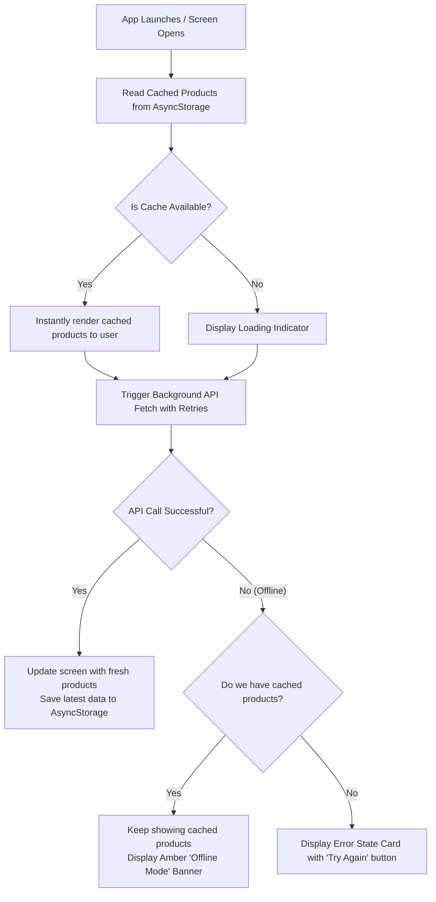

# KY TrendZone — Offline-First Mobile Reference App

[](https://github.com/KhadijaYaseen/offline-reference-app/actions)
[](LICENSE)
[](https://expo.dev)
[](https://www.typescriptlang.org/)

A production-grade **offline-first e-commerce reference application** built with React Native, Expo, and TypeScript. Designed as a mobile companion to the **KY TrendZone Boutique**, it demonstrates best practices for resilient mobile architecture: persistent client-side caching (`AsyncStorage`), graceful degradation under network outage, exponential backoff retries, and comprehensive state handling (Loading, Empty, Error, and Offline).

---

## 🎥 Demo Video

- **Video Walkthrough (Google Drive / Loom):** [Link to Demo Video](https://drive.google.com/) *(Paste your video link here)*
- **Flow Demonstrated:** Online catalog load $\rightarrow$ Airplane Mode toggle $\rightarrow$ Offline cache verification with pull-to-refresh $\rightarrow$ Offline detail view navigation.

---

## 🚀 Quick Start (Under 10 Minutes)

Follow these steps to clone, install, and run the application locally on any Android or iOS device via Expo Go.

### Prerequisites
- **Node.js**: v20 or higher (LTS recommended)
- **npm** or **yarn**
- **Expo Go App** (Android / iOS)

### Installation & Launch
```bash
# 1. Clone the repository
git clone https://github.com/KhadijaYaseen/offline-reference-app.git
cd offline-reference-app

# 2. Install dependencies
npm install

# 3. Start the Expo development server
npx expo start
```

### Running on your device:
- **Physical Phone**: Scan the terminal QR code using the **Expo Go** app.
- **Web Browser**: Press `w` in the terminal for a live web preview.
- **Android Emulator**: Press `a` in the terminal.

---

## 🏛️ Architecture Overview

The codebase is organized with clear separation of concerns:

```
offline-reference-app/
├── .github/
│   └── workflows/
│       └── ci.yml               # Automated CI: TypeScript check & Jest unit tests
├── __tests__/                   # Automated Unit Tests
│   ├── cache.test.ts            # Tests for AsyncStorage write, read, and empty fallback
│   └── productsApi.test.ts      # Tests for API fetch, retry loop & backoff resilience
├── src/
│   ├── api/
│   │   └── productsApi.ts       # Public FakeStore API client with 3-attempt exponential retry
│   ├── services/
│   │   └── cache.ts             # AsyncStorage service for local persistence
│   ├── hooks/
│   │   └── useProducts.ts       # State orchestrator managing cache fallback & network sync
│   ├── types/
│   │   └── product.ts           # TypeScript interfaces (Product, RootStackParamList)
│   ├── components/
│   │   ├── OfflineBanner.tsx    # Amber indicator for offline mode
│   │   └── ProductCard.tsx      # Clean e-commerce product card
│   └── screens/
│       ├── HomeScreen.tsx       # Searchable catalog, pull-to-refresh & retry view
│       └── DetailScreen.tsx     # Full product details, image, price & Add-to-Cart
├── App.tsx                      # Root component with SafeAreaProvider & NativeStack navigation
├── app.json                     # Expo configuration with custom KY TrendZone branding
├── package.json                 # Scripts: start, lint, test
└── README.md                    # Project documentation
```

---

## 📡 Offline Caching & Resiliency Behavior



### 1. Storage Engine
Cached catalog items are serialized as JSON and stored in persistent device storage via `@react-native-async-storage/async-storage` using the key `@trendzone_products`.

### 2. Exponential Backoff Retry Strategy
Network requests do not immediately fail on transient network hiccups. Instead, requests retry up to 3 times with exponential backoff:
$$\text{delay} = \text{attempt} \times 1000\text{ ms}$$
- **Attempt 1:** Immediate request
- **Attempt 2:** Wait 1,000ms before retrying
- **Attempt 3:** Wait 2,000ms before final fallback

---

## 🧪 Automated Testing

Comprehensive unit tests verify both the offline cache service and the network retry resilience.

```bash
# Run all automated tests
npm test

# Run TypeScript type check
npm run lint
```

### Test Coverage:
- **`__tests__/cache.test.ts`**:
  - ✅ Verifies saving and retrieving serialized product lists to/from AsyncStorage.
  - ✅ Verifies safe fallback to empty array `[]` when cache is empty.
- **`__tests__/productsApi.test.ts`**:
  - ✅ Verifies first-try success resolution.
  - ✅ Verifies automatic retry recovery on network drop.

---

## 🔒 Security Note: Never Commit Secrets

> [!CAUTION]
> **Never commit secrets, API keys, passwords, or personal access tokens into version control.**
> This repository uses `.gitignore` to prevent committing sensitive local files (`.env`, `.env.local`, credentials, keystores, and IDE configs). In production, inject secrets via environment variables or CI/CD secrets.

---

## 📢 Public Mock Data Disclaimer

This project uses public mock data provided by the free, open-access **[FakeStore API](https://fakestoreapi.com/products)**. No proprietary, customer, or confidential data is used or stored.

---

## 📜 License

This project is licensed under the **[MIT License](LICENSE)** - Copyright © 2026 Khadija Yaseen.
